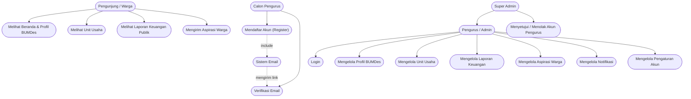
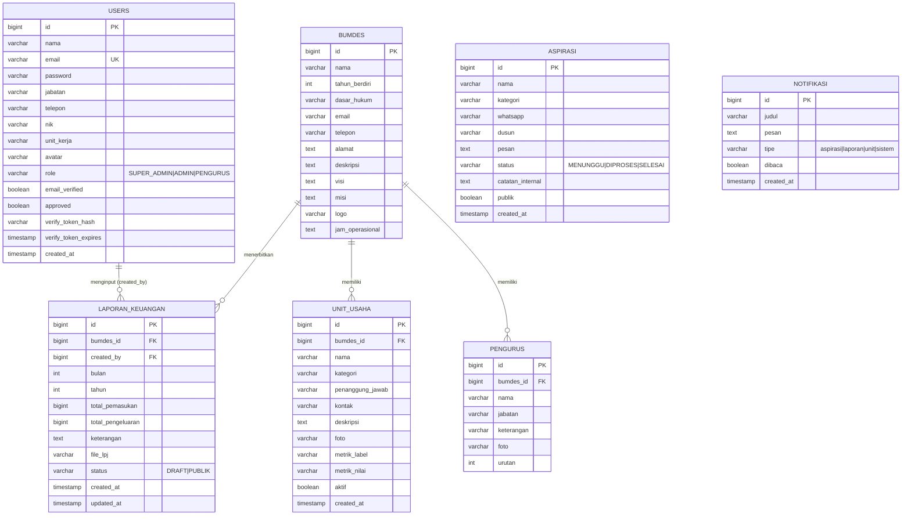

# PERANCANGAN SISTEM — WEBSITE BUMDES DESA KALIBAKUNG

> Dokumen perancangan untuk Proposal Kerja Praktik, mengikuti format contoh proposal
> (Use Case Diagram, ERD, dan Tabel ERD). Basis data sebenarnya memakai **PostgreSQL
> + Prisma ORM**; pada dokumen ini tipe data ditulis dalam gaya MySQL (Bigint, Varchar,
> Timestamp, dst.) agar konsisten dengan format proposal. Catatan penerapan PostgreSQL
> disertakan di akhir.

---

## 1. Use Case Diagram

Sistem memiliki **empat aktor**:

| Aktor | Keterangan |
|---|---|
| **Pengunjung (Warga)** | Masyarakat umum yang membuka portal publik tanpa login. |
| **Calon Pengurus** | Orang yang mendaftarkan diri sebagai pengurus (wajib email Gmail). |
| **Pengurus (Admin)** | Pengurus yang sudah disetujui, mengelola data operasional BUMDes. |
| **Super Admin** | Pengurus dengan hak tertinggi, termasuk menyetujui akun pengurus baru. |
| **Sistem Email** | Aktor eksternal yang mengirim link verifikasi email. |

### 1.1 Diagram Use Case

> **Keterangan relasi:**
> - Panah `-->` : aktor menggunakan use case (asosiasi).
> - `UC5 --> E` dengan label *include* : proses registrasi selalu meminta Sistem Email
>   mengirim link verifikasi.
> - `SA --> A` : Super Admin mewarisi semua hak akses Pengurus (generalization).

### 1.2 Ringkasan Use Case

| No | Use Case | Aktor |
|---|---|---|
| UC1 | Melihat Beranda & Profil BUMDes | Pengunjung |
| UC2 | Melihat Unit Usaha | Pengunjung |
| UC3 | Melihat Laporan Keuangan Publik | Pengunjung |
| UC4 | Mengirim Aspirasi Warga | Pengunjung |
| UC5 | Mendaftar Akun (Register) | Calon Pengurus |
| UC6 | Verifikasi Email | Calon Pengurus + Sistem Email |
| UC7 | Login | Pengurus, Super Admin |
| UC8 | Mengelola Profil BUMDes | Pengurus |
| UC9 | Mengelola Unit Usaha | Pengurus |
| UC10 | Mengelola Laporan Keuangan | Pengurus |
| UC11 | Mengelola Aspirasi Warga | Pengurus |
| UC12 | Mengelola Notifikasi | Pengurus |
| UC13 | Mengelola Pengaturan Akun | Pengurus |
| UC14 | Menyetujui / Menolak Akun Pengurus | Super Admin |

---

## 2. Entity Relationship Diagram (ERD)

### 2.1 Diagram ERD

### 2.2 Penjelasan Relasi Antar Entitas

| No | Entitas | Relasi | Entitas | Kardinalitas | Keterangan |
|---|---|---|---|---|---|
| 1 | USERS | menginput | LAPORAN_KEUANGAN | 1 : M | Satu pengurus dapat menginput banyak laporan; satu laporan diinput satu pengurus. |
| 2 | BUMDES | memiliki | UNIT_USAHA | 1 : M | Satu BUMDes memiliki banyak unit usaha. |
| 3 | BUMDES | menerbitkan | LAPORAN_KEUANGAN | 1 : M | Satu BUMDes menerbitkan banyak laporan keuangan bulanan. |
| 4 | BUMDES | memiliki | PENGURUS | 1 : M | Satu BUMDes memiliki banyak pengurus (struktur organisasi). |

> **Catatan khusus:**
> - Tabel **ASPIRASI** tidak memiliki *foreign key* ke `users`, karena aspirasi dikirim
>   oleh **pengunjung umum** (warga) yang tidak wajib punya akun. Data penindaklanjutan
>   disimpan pada kolom `status` dan `catatan_internal`.
> - Tabel **NOTIFIKASI** bersifat **log global**: semua pengurus melihat notifikasi yang
>   sama. Bila kelak dibutuhkan notifikasi per pengguna, tambahkan kolom `user_id`.

---

## 3. Tabel ERD

### Tabel 1. Perancangan Tabel Pengguna (`users`)

Struktur tabel pengguna menyimpan akun pengurus (admin), kredensial login, status
verifikasi email, dan status persetujuan akun.

| No | Nama Field | Type | Keterangan |
|---|---|---|---|
| 1 | id | Bigint(20) | Auto_increment, Primary Key |
| 2 | nama | Varchar(255) | Not Null |
| 3 | email | Varchar(255) | Not Null, Unique |
| 4 | password | Varchar(255) | Not Null (hash bcrypt) |
| 5 | jabatan | Varchar(255) | Null |
| 6 | telepon | Varchar(255) | Null |
| 7 | nik | Varchar(255) | Null |
| 8 | unit_kerja | Varchar(255) | Null |
| 9 | avatar | Varchar(255) | Null (nama file foto) |
| 10 | role | Varchar(255) | SUPER_ADMIN / ADMIN / PENGURUS |
| 11 | email_verified | Tinyint(1) | 0 = belum, 1 = terverifikasi |
| 12 | approved | Tinyint(1) | 0 = menunggu, 1 = disetujui |
| 13 | verify_token_hash | Varchar(255) | Null (hash token verifikasi) |
| 14 | verify_token_expires | Timestamp | Null (kedaluwarsa 24 jam) |
| 15 | created_at | Timestamp | Null |

### Tabel 2. Perancangan Tabel Data BUMDes (`bumdes`)

Tabel identitas lembaga; bersifat statis dan umumnya hanya satu baris (id = 1).

| No | Nama Field | Type | Keterangan |
|---|---|---|---|
| 1 | id | Bigint(20) | Auto_increment, Primary Key |
| 2 | nama | Varchar(255) | Not Null |
| 3 | tahun_berdiri | Int(4) | Null |
| 4 | dasar_hukum | Varchar(255) | Null (Perdes / SK) |
| 5 | email | Varchar(255) | Null |
| 6 | telepon | Varchar(255) | Null |
| 7 | alamat | Text | Null |
| 8 | deskripsi | Text | Null (slogan beranda publik) |
| 9 | visi | Text | Null |
| 10 | misi | Text | Null |
| 11 | logo | Varchar(255) | Null (nama file logo) |
| 12 | jam_operasional | Text | Null (format `Hari \| Jam`) |

### Tabel 3. Perancangan Tabel Pengurus (`pengurus`)

Menyimpan struktur pengurus yang ditampilkan di profil dan portal publik.

| No | Nama Field | Type | Keterangan |
|---|---|---|---|
| 1 | id | Bigint(20) | Auto_increment, Primary Key |
| 2 | bumdes_id | Bigint(20) | Not Null, Foreign Key → bumdes.id |
| 3 | nama | Varchar(255) | Not Null |
| 4 | jabatan | Varchar(255) | Not Null |
| 5 | keterangan | Varchar(255) | Null (periode / No. SK) |
| 6 | foto | Varchar(255) | Null (nama file foto) |
| 7 | urutan | Int(10) | Default 0 (urutan tampil) |

### Tabel 4. Perancangan Tabel Unit Usaha (`unit_usaha`)

Menyimpan unit usaha yang dikelola BUMDes dan status tampil di publik.

| No | Nama Field | Type | Keterangan |
|---|---|---|---|
| 1 | id | Bigint(20) | Auto_increment, Primary Key |
| 2 | bumdes_id | Bigint(20) | Not Null, Foreign Key → bumdes.id |
| 3 | nama | Varchar(255) | Not Null |
| 4 | kategori | Varchar(255) | Not Null |
| 5 | penanggung_jawab | Varchar(255) | Null |
| 6 | kontak | Varchar(255) | Null |
| 7 | deskripsi | Text | Null |
| 8 | foto | Varchar(255) | Null (nama file foto) |
| 9 | metrik_label | Varchar(255) | Null (mis. Omset Bulanan) |
| 10 | metrik_nilai | Varchar(255) | Null (mis. Rp 18.250.000/bln) |
| 11 | aktif | Tinyint(1) | Default 1 (tampil di publik) |
| 12 | created_at | Timestamp | Null |

### Tabel 5. Perancangan Tabel Laporan Keuangan (`laporan_keuangan`)

Rekap buku kas bulanan. `saldo_bersih` **tidak disimpan** karena dihitung otomatis:
`total_pemasukan − total_pengeluaran`.

| No | Nama Field | Type | Keterangan |
|---|---|---|---|
| 1 | id | Bigint(20) | Auto_increment, Primary Key |
| 2 | bumdes_id | Bigint(20) | Not Null, Foreign Key → bumdes.id |
| 3 | created_by | Bigint(20) | Null, Foreign Key → users.id |
| 4 | bulan | Int(2) | Not Null (1–12) |
| 5 | tahun | Int(4) | Not Null |
| 6 | total_pemasukan | Bigint(20) | Not Null |
| 7 | total_pengeluaran | Bigint(20) | Not Null |
| 8 | keterangan | Text | Null |
| 9 | file_lpj | Varchar(255) | Null (PDF/Excel LPJ) |
| 10 | status | Varchar(255) | DRAFT / PUBLIK |
| 11 | created_at | Timestamp | Null |
| 12 | updated_at | Timestamp | Null |

> *Unique constraint:* kombinasi `bumdes_id + bulan + tahun` harus unik agar satu periode
> hanya memiliki satu laporan.

### Tabel 6. Perancangan Tabel Aspirasi (`aspirasi`)

Menyimpan aspirasi dan keluhan warga yang dikirim dari portal publik.

| No | Nama Field | Type | Keterangan |
|---|---|---|---|
| 1 | id | Bigint(20) | Auto_increment, Primary Key |
| 2 | nama | Varchar(255) | Not Null |
| 3 | kategori | Varchar(255) | Not Null |
| 4 | whatsapp | Varchar(255) | Null (tidak ditampilkan publik) |
| 5 | dusun | Varchar(255) | Null |
| 6 | pesan | Text | Not Null |
| 7 | status | Varchar(255) | MENUNGGU / DIPROSES / SELESAI |
| 8 | catatan_internal | Text | Null (hanya admin) |
| 9 | publik | Tinyint(1) | 0 = tidak, 1 = tampil di portal |
| 10 | created_at | Timestamp | Null |

### Tabel 7. Perancangan Tabel Notifikasi (`notifikasi`)

Menyimpan log aktivitas sistem yang ditampilkan pada halaman notifikasi admin.

| No | Nama Field | Type | Keterangan |
|---|---|---|---|
| 1 | id | Bigint(20) | Auto_increment, Primary Key |
| 2 | judul | Varchar(255) | Not Null |
| 3 | pesan | Text | Not Null |
| 4 | tipe | Varchar(255) | aspirasi / laporan / unit / sistem |
| 5 | dibaca | Tinyint(1) | Default 0 |
| 6 | created_at | Timestamp | Null |

---

## 4. Catatan Implementasi (PostgreSQL + Prisma)

Dokumen tabel di atas memakai gaya tipe data MySQL agar seragam dengan format proposal.
Pada implementasi sesungguhnya (Nuxt 4 + Prisma + PostgreSQL), pemetaannya adalah:

| Gaya Proposal (MySQL) | Implementasi PostgreSQL |
|---|---|
| Bigint(20) | `Int` (auto-increment) / `BigInt` |
| Varchar(255) | `String` (TEXT) |
| Text | `String` (TEXT) |
| Int(10) | `Int` |
| Tinyint(1) | `Boolean` |
| Timestamp | `DateTime` |
| Auto_increment | `@id @default(autoincrement())` |

Model Prisma yang sudah berjalan terdapat pada file `prisma/schema.prisma`.
